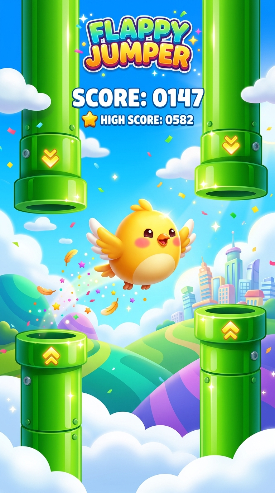

# 🐦 Flappy Bird Ultra (Phaser 3 + Capacitor)

> A polished, arcade-grade Flappy Bird clone built with the **Phaser 3 engine**, customized for the **Apple App Store** (iOS) and **Google Play Store** (Android) using **Capacitor**.



---

## ✨ Features

- **🎮 Phaser 3 Engine (High-Performance Arcade Physics)**: 60 FPS locked, delta-time aware, fluid gravity, responsive dive-and-rise rotation.
- **🎨 4 Unlockable Bird Skins**:
  - 🐥 **Classic Pip**: Ready from the start.
  - 🤖 **Cyber Neon**: Unlocks at High Score 10.
  - 🔥 **Crimson Ember**: Unlocks at High Score 25.
  - 👑 **Golden Phoenix**: Unlocks at High Score 50.
- **🎖️ Dynamic Medal System**:
  - 🥉 Bronze Medal (10+ pts)
  - 🥈 Silver Medal (20+ pts)
  - 🥇 Gold Medal (35+ pts)
  - 💎 Platinum Medal (50+ pts)
- **🔊 Procedural Web Audio Engine**: Zero missing audio files or network lag. Pure Web Audio synthesis for flap swoosh, coin chimes, hit impacts, and high score fanfares.
- **⚡ Zero-Lag Haptics**: Subtle vibrations on flap, score, and collisions using the Vibration API.
- **📱 100% Mobile & App Store Optimized**:
  - `viewport-fit=cover` for iPhone notch and Dynamic Island.
  - Complete elimination of rubber-band scrolling, pull-to-refresh, and unwanted gestures.
  - Fully offline capable — all engines and assets are self-contained.

---

## 🕹️ Controls

- **Desktop**: Click mouse, press `Spacebar`, or press `Up Arrow`.
- **Mobile / iOS**: Tap anywhere on the screen.

---

## 🖥️ Running Locally (Immediate Play)

A built-in Python web server is provided:

```bash
python serve.py
```

Then open `http://localhost:8080` in your browser.

---

## 📦 App Store Deployment

See the comprehensive guide in [APP_STORE_GUIDE.md](file:///c:/Users/user/Desktop/aa/APP_STORE_GUIDE.md) for full instructions on building the iOS project in Xcode and submitting to App Store Connect.
